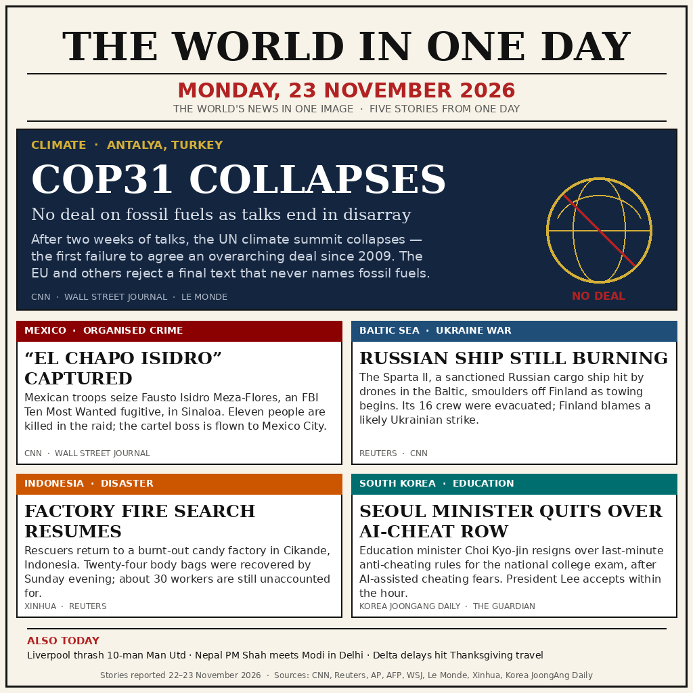

# The World in One Day — Monday, 23 November 2026

[](https://make.fun/bounty/news-image-20261123)
[](https://make.fun/bounty/news-image-20261123)
[](https://make.fun/bounty/news-image-20261123)
[](https://make.fun/bounty/news-image-20261123)

A newspaper front page summing up the world's news of **Monday 23 November
2026** in one image — an entry for the [make.fun](https://make.fun/bounty/news-image-20261123)
`news-image-20261123` bounty.



## The five stories

1. **COP31 collapses** — the UN climate talks in Antalya end without an
   overarching deal, the first such failure since 2009, after the EU and
   others reject a final text that never names fossil fuels.
   *(CNN · Wall Street Journal · Le Monde)*
2. **"El Chapo Isidro" captured** — Mexican troops seize FBI Ten Most Wanted
   fugitive Fausto Isidro Meza-Flores in Sinaloa; 11 people are killed in
   the raid. *(CNN · Wall Street Journal)*
3. **Russian ship still burning** — the sanctioned cargo ship Sparta II,
   hit by drones in the Baltic, smoulders off Finland as towing begins;
   its 16 crew were evacuated. *(Reuters · CNN)*
4. **Factory fire search resumes** — rescuers return to a burnt-out candy
   factory in Cikande, Indonesia; 24 body bags were recovered by Sunday
   evening, about 30 workers still unaccounted for. *(Xinhua · Reuters)*
5. **Seoul minister quits over AI-cheat row** — South Korea's education
   minister Choi Kyo-jin resigns over last-minute anti-cheating rules for
   the national college exam; President Lee accepts within the hour.
   *(Korea JoongAng Daily · The Guardian)*

Also today: Liverpool thrash 10-man Man Utd; Nepal PM Shah meets Modi in
Delhi; Delta delays hit Thanksgiving travel.

## How it was made

`entry.png` (1024×1024) was drawn fresh in the build session with PIL
(`draw_news.py`) — masthead, hero panel and four story panels, all text
laid out with DejaVu fonts. Every story was verified against real reporting
dated 22–23 November 2026 before it went on the page; nothing was invented.

## Run it

```sh
mkdir -p out && MAKEFUN_OUTPUT_DIR=out node main.ts
```

`main.ts` (Node 22, standard library only) copies `entry.png` to
`$MAKEFUN_OUTPUT_DIR` (default `/output`). It runs with no network and
both runs write identical bytes.

## License

MIT — see [LICENSE](LICENSE).
